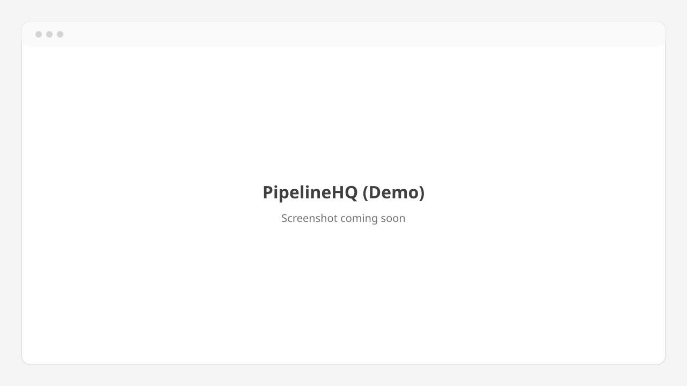

# PipelineHQ (Demo)

A CRM dashboard demo built as a portfolio project by **Emmanuel Kelvin**. It is
built to look and feel like a real SaaS product, but **it only uses fake data**.

Every visitor clicks **Explore the demo**, gets an anonymous Firebase session
and a private sandbox that is filled with fictional companies, contacts, deals,
activities and tasks. Visitors can change anything and reset the sandbox at any
time.

<!-- Replace with a real screenshot, e.g. docs/screenshot.png -->



## Stack

- [Next.js](https://nextjs.org) 16 (App Router, Cache Components) with
  TypeScript in strict mode
- [Tailwind CSS](https://tailwindcss.com) v4 and [shadcn/ui](https://ui.shadcn.com)
- [Firebase](https://firebase.google.com) client SDK: Anonymous Auth and
  Cloud Firestore (no Admin SDK, no service accounts)
- [Zod](https://zod.dev) schemas for every Firestore document
- [date-fns](https://date-fns.org), [Recharts](https://recharts.org) and
  [dnd-kit](https://dndkit.com) (charts and the drag-and-drop pipeline are
  coming in the next step)
- [Vitest](https://vitest.dev), ESLint and Prettier

## How it works

- `src/lib/firebase/` initialises Firebase once from `NEXT_PUBLIC_FIREBASE_*`
  and provides `AuthProvider` / `useAuth`. When the env vars are missing the
  app shows a "Firebase is not configured" notice instead of crashing.
- `src/lib/crm/` holds the data model: one Zod schema per entity, a typed
  repository (`repo.ts`) that converts Firestore Timestamps to `Date`s, and the
  seeding code.
- All data lives under `users/{uid}/...`, so each visitor has a private
  sandbox. `firestore.rules` only lets the signed-in owner read or write it.
- On first entry to `/app`, the sandbox is seeded from a deterministic
  generator (`src/lib/crm/seed-generator.ts`): 12 companies, 45 contacts,
  30 deals across every stage over the last 12 months, 120 activities and
  15 tasks. No network or external APIs are involved.

## Set up Firebase

1. Create a project in the [Firebase console](https://console.firebase.google.com).
   Google Analytics is not needed.
2. **Authentication** > **Get started** > **Sign-in method** > enable
   **Anonymous**.
3. **Firestore Database** > **Create database**. Pick a location and start in
   **production mode** (the rules below replace the defaults).
4. **Project settings** > **General** > **Your apps** > add a **Web app**.
   Copy the values from the `firebaseConfig` snippet.
5. **Firestore Database** > **Rules**: replace the contents with
   [`firestore.rules`](firestore.rules) from this repository and click
   **Publish**. No composite indexes are needed.
6. If you deploy the app, add its domain under **Authentication** >
   **Settings** > **Authorized domains** (`localhost` is allowed by default).

## Environment variables

Copy `.env.example` to `.env.local` and fill it in:

| Variable                                   | Value                                                |
| ------------------------------------------ | ---------------------------------------------------- |
| `NEXT_PUBLIC_FIREBASE_API_KEY`             | `apiKey` from the web app config                     |
| `NEXT_PUBLIC_FIREBASE_AUTH_DOMAIN`         | `authDomain`                                         |
| `NEXT_PUBLIC_FIREBASE_PROJECT_ID`          | `projectId`                                          |
| `NEXT_PUBLIC_FIREBASE_STORAGE_BUCKET`      | `storageBucket`                                      |
| `NEXT_PUBLIC_FIREBASE_MESSAGING_SENDER_ID` | `messagingSenderId`                                  |
| `NEXT_PUBLIC_FIREBASE_APP_ID`              | `appId`                                              |
| `NEXT_PUBLIC_PORTFOLIO_URL`                | Link to the developer's portfolio (optional)         |
| `NEXT_PUBLIC_FIREBASE_USE_EMULATORS`       | `true` to use the local emulators instead (optional) |

The `NEXT_PUBLIC_FIREBASE_*` values identify your project and end up in the
browser bundle. They are not secrets; access is controlled by Anonymous Auth
and the security rules. Real `.env*` files are gitignored, only `.env.example`
is committed. `NEXT_PUBLIC_*` values are inlined at build time, so rebuild after
changing them.

## Run locally

Requires Node.js 20.9 or newer.

```bash
npm install
cp .env.example .env.local   # then fill in the values
npm run dev                  # http://localhost:3000
```

### Without a Firebase project (emulators)

The [Firebase Emulator Suite](https://firebase.google.com/docs/emulator-suite)
runs Auth and Firestore locally, with `firestore.rules` enforced. It needs
Java 21 or newer.

```bash
npm run emulators            # Auth on :9099, Firestore on :8080
```

Then set `NEXT_PUBLIC_FIREBASE_USE_EMULATORS=true`,
`NEXT_PUBLIC_FIREBASE_PROJECT_ID=demo-pipelinehq` and any non-empty values for
the other `NEXT_PUBLIC_FIREBASE_*` variables in `.env.local`, and run
`npm run dev` in a second terminal.

### Scripts

| Script                 | What it does                                           |
| ---------------------- | ------------------------------------------------------ |
| `npm run dev`          | Start the dev server                                   |
| `npm run build`        | Production build                                       |
| `npm run lint`         | ESLint                                                 |
| `npm run format`       | Format with Prettier                                   |
| `npm run format:check` | Check formatting                                       |
| `npm test`             | Unit tests (seed generator, schemas, converters)       |
| `npm run test:rules`   | Security-rules tests against the Firestore emulator    |
| `npm run emulators`    | Start the Auth and Firestore emulators for development |

## Demo disclaimer

PipelineHQ is not a real product. It is a portfolio demo.

- All people, companies, emails (`example.com`), phone numbers (`555-01xx`),
  deals and activities are fictional and generated by code. Any resemblance to
  real people or companies is coincidental.
- Do not enter real personal or customer data.
- Each visitor's sandbox is private to their anonymous session. Signing out
  ends that session, and the sandbox cannot be recovered afterwards.
- The demo may be reset, changed or taken offline at any time.
